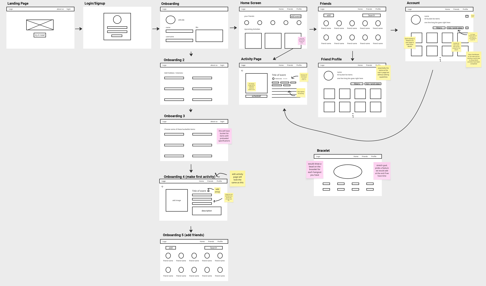

# Module 2 Group Assignment

CSCI 5117, Fall 2026, [assignment description](https://canvas.umn.edu/courses/579310/pages/project-2)

## App Info:

* Team Name: The Style Sheet Skinks
* App Name: TODO
* App Link: <https://developing-the-interactive-web-proj.vercel.app/>

### Students

* Han Tran, tran1229@umn.edu
* Brady Kloek, kloek016@umn.edu
* Amara Marx, marx0109@umn.edu
* Sarah Wood, wood1532@umn.edu
* Zoe Berrier, berri075@umn.edu

## Key Features

**Describe the most challenging features you implemented
(one sentence per bullet, maximum 4 bullets):**

* ...

Which (if any) device integration(s) does your app support?

* ...

Which (if any) progressive web app feature(s) does your app support?

* ...

## Mockup images

A single high-quality image capturing the entirety of the low-fidelity mockup for your convenience. We encourage our dear grader to click into this image to zoom and explore! Alternatively, follow this [Miro Link](https://miro.com/app/board/uXjVEP0TjOE=/?share_link_id=816105118159) which theoretically should allow you to view our Miro whiteboard for additional zooming fun.

## Testing Notes

**Is there anything special we need to know in order to effectively test your app? (optional):**

* ...

## Screenshots of Site (complete)

**[Add a screenshot of each key page](https://stackoverflow.com/questions/10189356/how-to-add-screenshot-to-readmes-in-github-repository)
along with a very brief caption:**

## External Dependencies

**Document integrations with 3rd Party code or services here.
Please do not document required libraries (e.g., VUE, Firebase, vuefire).**

* Library or service name: description of use
* ...

**If there's anything else you would like to disclose about how your project
relied on external code, expertise, or anything else, please disclose that
here:**

...
